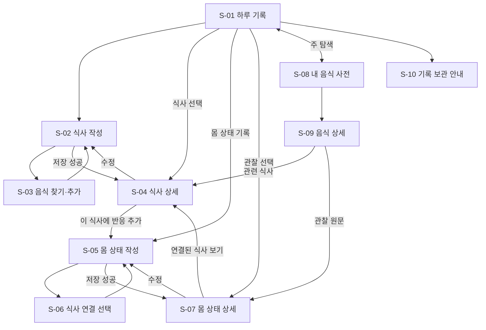

# 음식dictionary — User Flow & Screens

> 버전: v0.1 · 작성일: 2026-11-25 · 상태: 화면 설계 초안
> 근거: [One Pager](0_one_pager.md), [PRD](1_product_requirements_document.md), [User Stories](2_user_stories.md)
> 화면 구조와 이동 방식은 제안이다. 제품 목적과 네 관찰 영역은 유지하며, 플랫폼·저장·로그인·알림 방식은 아직 확정하지 않는다.

## 1. 설계 목적과 원칙

**식사 기록 → 몸 상태 기록 → 경험 비교 → 내 몸에 맞는 음식 이해**가 자연스럽게 이어지는 흐름을 만든다.

- 소화·속 편안함, 졸림, 에너지, 배변을 각각 기록한다. 모든 영역의 입력을 강제하지 않는다.
- 관찰은 여러 시점에 추가할 수 있고, 식사와 연결하지 않아도 남길 수 있다.
- 미기록과 모르겠음, 없음·보통을 구분한다. 긍정적인 반응도 명시적으로 기록한다.
- 음식 상세는 관찰의 분포와 원래 식사 맥락을 보여준다. 종합 점수·음식 순위·원인 판정은 제공하지 않는다.
- 휴대폰에서 기록하기 쉬운 구성을 먼저 설계하되 웹·네이티브 앱 여부는 확정하지 않는다.
- 문서의 시각과 음식은 모두 가상 예시다.

## 2. 정보 구조와 화면 목록

주 탐색은 **하루 기록 / 내 음식 사전** 두 곳으로 나눈다. 작성·상세 화면은 이 두 곳에서 열고, 완료 후 해당 기록이나 원래 탐색 위치로 돌아간다. 기록 보관 안내는 보조 링크로 접근한다.

| ID | 화면·보조 UI | 역할 | 연결 스토리 |
| --- | --- | --- | --- |
| S-01 | 하루 기록 | 날짜별 식사·관찰 타임라인과 기록 시작 | US-10, US-19 |
| S-02 | 식사 작성·수정 | 음식, 먹은 시각, 선택적 양·메모 입력 | US-02~03, US-14 |
| S-03 | 음식 찾기·추가 | 기존 음식 검색·선택 또는 새 항목 생성 | US-01 |
| S-04 | 식사 상세 | 식사 맥락과 연결된 관찰 확인·추가 | US-08, US-11, US-15 |
| S-05 | 몸 상태 작성·수정 | 네 영역 중 관찰한 내용 입력 | US-04~09, US-14 |
| S-06 | 식사 연결 선택 | 관찰에 연결할 식사 선택·변경·해제 | US-07~08, US-14 |
| S-07 | 몸 상태 상세 | 원래 관찰, 미기록 영역, 식사 연결 확인 | US-09~10, US-16 |
| S-08 | 내 음식 사전 | 음식 검색과 상세 진입 | US-11 |
| S-09 | 음식 상세 | 영역별 요약과 관련 식사 탐색 | US-11~13 |
| S-10 | 기록 보관 안내 | 선택된 저장 방식의 비공개·보존 범위 안내 | US-18 |
| D-01 | 삭제 확인 | 삭제 대상과 영향을 확인 | US-15~16 |
| D-02 | 작성 취소 확인 | 저장하지 않은 변경을 버릴지 확인 | US-17 보완 제안 |

S-03·S-06은 휴대폰에서 별도 선택 화면 또는 시트로 표현할 수 있다. 화면 ID는 역할을 구분하며, 실제 페이지 수나 기술 구조를 지정하지 않는다. 저장·접근성 관련 US-17~19는 모든 관련 화면에 적용한다.

## 3. 전체 이동 지도

삭제·취소 확인은 해당 상세·작성 화면 위에 열리는 보조 UI이며, 별도 탐색 목적지가 아니다.

## 4. 주요 사용자 흐름

### F-01. 음식과 한 끼 남기기

**관련:** US-01~03 · FR-01 · AC-01

1. S-01에서 `식사 기록`을 선택한다. S-02의 먹은 시각은 현재를 기본값으로 표시한다.
2. `음식 추가`로 S-03을 연다. 기존 음식을 선택하거나 새 이름을 만들어 작성 중인 식사에 추가한다.
3. S-02에서 필요한 만큼 음식을 추가하고, 양·메모와 먹은 시각을 확인한다.
4. `식사 저장`을 선택한다. 성공하면 S-04에서 저장한 식사를 보여준다.
5. `몸 상태 추가`로 F-02를 이어가거나, 하루 기록으로 돌아간다. 식사 저장과 관찰 입력은 별개이며 관찰을 즉시 강제하지 않는다.

**분기:** 음식이나 유효한 시각이 없으면 S-02에서 오류를 안내한다. 검색 결과가 없으면 S-03에서 새 이름으로 추가할 수 있다. 저장 실패 시 입력을 유지한다.

### F-02. 식사 후 반응을 여러 시점에 남기기

**관련:** US-04~06, US-08~09 · FR-02~03 · AC-02~03, AC-05

1. S-04에서 `몸 상태 추가`를 선택하면 S-05에 해당 식사가 연결된다.
2. 실제 관찰 시각과 관찰한 영역만 입력한다. 예: 소화는 `편안함`, 졸림은 `많이`.
3. `몸 상태 저장`이 성공하면 S-07에서 입력한 값과 미기록 영역을 구분해 보여준다.
4. 시간이 지난 뒤 S-04에서 다시 `몸 상태 추가`를 선택하면 새 관찰을 만든다. 앞선 값을 고치려면 해당 관찰의 `수정`으로 들어간다.

**분기:** 관찰 시각이 식사보다 이르면 저장을 막고 시각 수정 또는 연결 해제를 안내한다. 한 영역도 응답하지 않았다면 필요한 입력을 안내한다.

### F-03. 식사 연결 없이 배변·몸 상태 남기기

**관련:** US-07, US-09 · FR-02~03 · AC-04~05

1. S-01에서 `몸 상태 기록`을 선택한다. S-05의 식사 연결은 기본적으로 `연결 안 함`이다.
2. 관찰 시각과 배변 등 필요한 영역을 입력한다. 배변은 실제 사건 시각을 사용한다.
3. 저장 후 S-07에 `연결된 식사 없음`을 표시한다. S-01에는 관찰한 날짜의 독립 기록으로 표시한다.
4. 나중에 연결하고 싶다면 S-07의 `수정` → S-06에서 식사를 선택한다.

**분기:** 배변과 다른 몸 상태를 느낀 시각이 다르면 관찰을 각각 기록한다. 독립 기록은 사용자가 연결하기 전까지 음식별 집계에 넣지 않는다.

### F-04. 음식별 경험 비교하기

**관련:** US-11~13 · FR-05 · AC-06, AC-10

1. S-08에서 음식 이름을 검색해 S-09로 들어간다.
2. 전체·최근 7일·최근 30일 중 기간을 선택한다.
3. 음식이 포함된 식사 수와 영역별 관찰 수·응답 분포를 확인한다.
4. 관련 식사를 선택해 S-04에서 함께 먹은 음식과 메모를 확인하거나, 관찰을 선택해 S-07에서 원문을 읽는다.
5. 뒤로 가면 S-09의 기간·조회 위치를 유지한다.

**분기:** 선택 기간의 식사가 없으면 기간 변경을 안내한다. 식사는 있지만 해당 영역의 관찰이 없으면 미기록 상태를 보여준다. 둘을 동일한 빈 상태로 표현하지 않는다.

### F-05. 내용·시각·연결 수정하기

**관련:** US-14 · FR-06 · AC-07

1. S-04 또는 S-07의 `수정`을 선택한다.
2. 기존 값이 채워진 S-02 또는 S-05에서 변경한다. 관찰의 식사 연결은 S-06에서 바꾼다.
3. 저장하면 기존 기록의 상세로 돌아간다. 새 관찰을 만들지 않으며 타임라인·음식별 요약도 함께 갱신한다.

**분기:** 시각 변경으로 관찰이 연결된 식사보다 앞서면 저장을 막는다. 작성 중 취소하면 D-02에서 `계속 작성` 또는 `변경 버리기`를 고를 수 있다. 이는 작성 취소에 대한 추가 UX 제안이다.

### F-06. 식사 또는 관찰 삭제하기

**관련:** US-15~16 · FR-06 · AC-07

- **식사 삭제:** S-04 → D-01에서 연결된 관찰 수 확인 → 삭제 확인 → S-01의 해당 날짜. 식사만 삭제하고 관찰은 연결을 해제해 보존한다.
- **관찰 삭제:** S-07 → D-01 → 삭제 확인 → 진입했던 타임라인·식사 상세·음식 상세. 선택 관찰만 삭제하고 식사와 다른 관찰은 유지한다.
- 취소하면 원래 상세를 유지한다. 삭제 실패 시 상세와 데이터는 유지하고 재시도를 안내한다.

## 5. 화면별 구성

### S-01. 하루 기록

**배치 순서:** 날짜 선택 → `식사 기록`·`몸 상태 기록` → 시간순 기록 목록 → 주 탐색.

- 기본 날짜는 오늘이며 이전·다음 날짜 또는 날짜 선택으로 이동한다.
- 식사 항목: 먹은 시각, 음식 이름들, 식사 상세 진입.
- 관찰 항목: 관찰 시각, 입력한 영역과 응답, 연결된 식사와 먹은 시각·식후 경과 시간 또는 `연결된 식사 없음`.
- 같은 사건 시각이면 생성 순서로 표시한다. 자정을 넘은 관찰은 관찰 날짜에 표시하며 전날 식사 연결을 유지한다.
- **빈 상태:** `아직 남긴 기록이 없어요`와 두 기록 동작을 제공한다.
- **이동:** 기록 상세를 열었다 돌아오면 선택 날짜와 조회 위치를 유지한다. 보조 링크로 S-10에 접근한다.

### S-02. 식사 작성·수정

**배치 순서:** 제목·취소 → 먹은 날짜/시각 → 음식 목록·음식 추가 → 식사 메모 → 저장.

| 항목 | 필수 | 동작 |
| --- | --- | --- |
| 먹은 날짜·시각 | 예 | 현재 기본값, 과거 입력 허용 |
| 음식 목록 | 최소 1개 | S-03에서 추가, 작성 목록에서 제거·교체 |
| 음식별 양 | 아니오 | 짧은 자유 입력, 예: 반 공기 |
| 식사 메모 | 아니오 | 조리 방식·상황 등 자유 입력 |

`식사 저장` 또는 수정 모드의 `변경 저장`을 사용한다. 음식·시각 누락은 해당 필드 옆에 표시한다. 저장 중 재제출을 막고, 실패하면 입력을 유지한다. 사진과 구조화된 재료 입력은 현재 화면에 필수 항목으로 넣지 않는다.

### S-03. 음식 찾기·추가

**배치 순서:** 뒤로 → 이름 검색 → 검색 결과 → 새 이름 추가 동작.

- 결과 선택 시 작성 중인 S-02에 음식을 추가하고 돌아간다. 기존 입력값은 유지한다.
- 이름의 앞뒤 공백은 제거하며, 같은 이름이면 기존 항목을 먼저 제안한다.
- 검색 결과가 없으면 `‘입력한 이름’ 추가`를 제공한다. 공백만 입력한 경우 생성하지 않는다.
- 유사한 이름을 자동으로 합치지 않는다. 음식 전체의 이름 변경·병합·삭제 기능은 제공하지 않는다.

### S-04. 식사 상세

**배치 순서:** 뒤로·수정/삭제 → 먹은 시각 → 음식·양·메모 → `몸 상태 추가` → 연결된 관찰 목록.

- 관찰 목록에는 실제 관찰 시각과 식후 경과 시간, 입력한 영역을 표시한다. 선택하면 S-07로 이동한다.
- **빈 상태:** `아직 이 식사에 남긴 몸 상태가 없어요`와 추가 동작. 좋은 반응이었다고 해석하지 않는다.
- 수정은 S-02에 기존 값을 전달하고, 추가는 S-05에 식사 연결만 전달한다. 새 관찰의 응답을 이전 관찰에서 자동으로 복사하지 않는다.
- 삭제는 D-01에서 영향을 확인한다.

### S-05. 몸 상태 작성·수정

**배치 순서:** 제목·취소 → 관찰 날짜/시각 → 식사 연결 → 네 영역 선택·입력 → 선택 메모 → 저장.

| 영역 | 기본 응답 | 선택 상세 |
| --- | --- | --- |
| 소화·속 편안함 | 편안함 / 보통 / 불편함 / 모르겠음 | 더부룩함·속쓰림·복부 불편감·가스·메스꺼움, 항목별 약함·중간·심함 |
| 졸림 | 없음 / 약간 / 많이 / 모르겠음 | 메모 |
| 에너지 | 활력 있음 / 평소와 비슷함 / 기운 없음 / 모르겠음 | 메모 |
| 배변 | 편안함 / 보통 / 불편함 / 모르겠음 | 변의 상태: 단단함 / 보통 / 묽음 / 모르겠음, 메모 |

- 네 영역은 모두 발견할 수 있게 표시하되, 상세 입력은 선택한 영역만 펼치는 방식을 제안한다. 초기 응답을 자동 선택하지 않는다.
- 관찰 시각과 최소 한 영역의 기본 응답이 필요하다. 선택했던 응답을 지워 미기록으로 돌릴 수 있다.
- 배변의 관찰 시각은 사건 시각이다. 다른 시간의 상태는 별도 기록하도록 안내한다.
- 소화 상세 증상을 선택하면 기본 응답도 필요하다. 편안함과 불편 증상을 함께 선택하면 `이대로 기록할까요?` 확인을 제공하고 수정 또는 그대로 저장할 수 있게 한다.
- 졸림 응답으로 에너지 등 다른 영역을 추론하지 않는다.
- 식사보다 이른 관찰, 필수값 누락, 저장 실패는 해당 화면에서 해결한다. 실패 후 재시도 시 중복 기록을 만들지 않는다.
- 저장 성공은 S-07로 이동한다. 식사 선택 화면을 다녀와도 작성 값은 유지한다.

### S-06. 식사 연결 선택

**배치 순서:** 닫기 → `연결 안 함` → 날짜 선택 → 식사 목록.

- 현재 연결 여부를 표시하고, 다른 날짜의 식사도 찾아 선택할 수 있다. 이는 식사 선택을 위한 UX 제안이다.
- 목록은 먹은 시각과 음식 이름을 보여준다. 관찰 시각보다 나중인 식사는 선택할 수 없으며 이유를 표시한다.
- 선택 시 S-05의 연결만 변경한다. 관찰 자체는 S-05에서 저장해야 반영된다.
- `연결 안 함`을 선택하면 연결을 해제한 상태로 돌아간다. 닫기를 선택하면 기존 연결을 유지한다.
- **빈 상태:** `이 날짜에 식사 기록이 없어요`. 다른 날짜 선택 또는 연결 없이 계속하기를 제공한다.

### S-07. 몸 상태 상세

**배치 순서:** 뒤로·수정/삭제 → 관찰 시각 → 식사 연결·경과 시간 → 영역별 값 → 상세·메모.

- 입력한 응답은 원래 표현으로 보여주고 입력하지 않은 영역은 `미기록`으로 구분한다.
- `모르겠음`과 `없음`·`보통`을 미기록으로 합치지 않는다.
- 연결된 식사는 S-04로 이동할 수 있다. 독립 관찰에는 `연결된 식사 없음`을 표시한다.
- `수정`에서 연결도 변경할 수 있으며, `삭제`는 D-01을 거친다.

### S-08. 내 음식 사전

**배치 순서:** 제목 → 이름 검색 → 음식 목록 → 주 탐색.

- 음식 선택 시 S-09로 이동한다. 자동 건강 순위나 추천 목록을 만들지 않는다.
- **최초 빈 상태:** `식사를 기록하며 나만의 음식 사전을 쌓아보세요`와 `식사 기록` 동작.
- **검색 결과 없음:** `일치하는 음식이 없어요`와 검색어 수정 동작. 음식 생성은 식사 작성 흐름의 S-03에서 수행한다.
- 상세에서 돌아오면 검색어와 조회 위치를 유지한다.

### S-09. 음식 상세

**배치 순서:** 음식 이름 → 기간 선택 → 해당 음식이 포함된 식사 수 → 영역별 요약 → 관련 식사·관찰.

- 기간: 전체 / 최근 7일 / 최근 30일. 포함할 식사는 먹은 시각으로 선택하고, 그 식사에 연결된 관찰은 날짜가 넘어가도 포함한다.
- 영역마다 **관찰 수**, **관찰한 고유 식사 수**, **응답별 건수**, **해당 영역 미기록 식사 수**를 보여준다.
- 같은 식사의 두 관찰은 관찰 수 2, 관찰한 식사 수 1이다. 같은 음식이 한 식사에 반복되어도 식사 수는 1이다.
- 모르겠음은 응답 건수에 포함하고, 미기록은 분포에서 제외한다. 영역 간 수치를 하나의 건강 점수로 합치지 않는다.
- `이 음식을 포함한 식사에서 남긴 기록` 문구와 함께 먹은 음식을 보여주고, 식사·관찰 원문으로 이동하게 한다.
- 관찰이 없으면 `아직 반응 기록이 없어요`, 기간 내 식사가 없으면 `이 기간에 식사 기록이 없어요`를 구분한다.
- 독립 관찰은 표시·집계하지 않는다. 배변 결과를 음식의 효과로 표현하지 않는다.

### S-10. 기록 보관 안내

- 개인 기록이 기본 비공개이며 공개 링크·검색 노출을 제공하지 않음을 안내한다.
- 실제 저장 방식이 정해지면 보관 위치, 접근 범위, 삭제·기기 변경 시 보존 범위를 구체적으로 보여준다.
- 서버 저장이면 계정별 접근 제한, 기기 저장이면 해당 방식의 보존 한계를 설명한다. 미구현 로그인·동기화를 작동하는 기능처럼 표시하지 않는다.
- 최초 실제 기록 전에 읽을 수 있게 제공하고 S-01에서 다시 접근하게 한다. 현재 목업에서는 저장 방식 미정이라는 설계 주석으로 관리한다.

## 6. 공통 상태와 복귀 규칙

| 상황 | 화면 처리 | 결과·복귀 |
| --- | --- | --- |
| 조회 중 | 로딩 상태 표시 | 완료 후 내용 또는 빈 상태 |
| 조회 실패 | 빈 기록처럼 보이지 않도록 오류와 재시도 제공 | 동일 화면에서 다시 조회 |
| 필수 입력 오류 | 해당 필드에 설명 표시, 입력 유지 | 수정 후 저장 |
| 저장 중 | 저장 진행 표시, 중복 제출 방지 | 완료 전 성공 메시지 없음 |
| 저장 실패 | 입력 유지, 실패 안내와 재시도 | 중복 없이 저장 재시도 |
| 저장 성공 | 저장된 값이 보이는 상세로 이동 | 타임라인·요약 갱신 |
| 선택 화면 취소 | 음식·식사 연결 변경을 취소 | 작성 값 유지 |
| 변경 없는 작성 취소 | 바로 이전 화면 복귀 | 저장 없음 |
| 변경 있는 작성 취소 | D-02: 계속 작성 / 변경 버리기 | 사용자가 고른 동작 적용 |
| 삭제 확인 취소 | D-01 닫기 | 원래 기록·연결 유지 |
| 삭제 실패 | 기존 기록 유지, 재시도 안내 | 동일 상세 유지 |

- **D-01 식사 삭제 문구 예시:** `이 식사를 삭제할까요? 연결된 몸 상태 기록 2개는 식사 연결 없이 남습니다.`
- **D-01 관찰 삭제 문구 예시:** `이 몸 상태 기록을 삭제할까요? 식사와 다른 몸 상태 기록은 유지됩니다.`
- **D-02 문구 예시:** `저장하지 않은 변경을 버릴까요?`
- 뒤로 가기는 진입한 화면으로 돌아가며 날짜·검색어·기간을 유지한다. 새로 만든 상세에서 뒤로 가면 제출 완료된 작성 폼을 다시 열지 않고 진입했던 탐색 화면으로 돌아간다.
- 상세에서 상세로 이동한 경우 탐색 맥락을 유지한다. 삭제한 상세로 복귀하게 되는 경우 해당 날짜의 S-01로 이동한다.
- 저장 완료된 기록은 재실행 후 다시 조회한다. 미저장 초안의 재실행 복구는 현재 범위에 포함하지 않는다.
- 모든 상태는 텍스트로 이해할 수 있어야 하며 색상만으로 선택·반응·오류를 구분하지 않는다.

## 7. 목업 제작 범위와 검토 시나리오

### 우선 제작할 화면

S-01 하루 기록, S-02 식사 작성, S-04 식사 상세, S-05 몸 상태 작성, S-07 몸 상태 상세, S-08 음식 사전, S-09 음식 상세를 핵심 화면으로 만든다. S-03·S-06 선택 화면과 D-01·D-02 확인 UI를 연결해 흐름을 완성한다. S-10은 저장 방식 미정 상태를 표시한 보조 화면으로 포함한다.

### 반드시 보여줄 상태

| 검토 장면 | 확인할 점 | PRD 검증 |
| --- | --- | --- |
| 최초 방문 | 빈 타임라인에서 식사 또는 독립 관찰 시작 가능 | AC-10 |
| 음식 두 개와 과거 식사 | 하나의 식사로 저장, 올바른 날짜 표시 | AC-01 |
| 소화·졸림만 입력 | 다른 영역은 미기록, 값 자동 추론 없음 | AC-02, AC-05 |
| 같은 식사에 두 관찰 | 시간별 기록 보존, 관찰 수와 식사 수 구분 | AC-03 |
| 독립 배변 기록 | 식사 선택 없이 저장, 음식 집계 제외 | AC-04 |
| 자정을 넘은 관찰 | 다음 날 타임라인과 전날 식사 연결 | AC-08 |
| 음식별 요약·기간 변경 | 함께 먹은 음식과 원문 접근, 분포·표본 수 동시 변경 | AC-06, AC-10 |
| 수정과 삭제 | 관찰 보존 또는 삭제 범위 명확, 집계 갱신 | AC-07 |
| 오류와 재시도 | 입력 보존, 중복 제출 방지 | AC-09 |
| 기록 보관 안내 | 저장 방식에 따른 실제 보존·접근 범위 설명 | AC-11 |

목업은 가상 기록으로 동작과 화면을 검토하는 용도다. 실제 영구 저장·사용자 접근 제어·재실행 복구는 구현 후 별도로 검증하며, 목업만으로 AC-11을 통과했다고 판단하지 않는다.

## 8. 남은 결정

| 항목 | 현재 상태 |
| --- | --- |
| 웹 또는 앱 | 휴대폰 우선 화면만 제안, 플랫폼 미정 |
| 저장·로그인 | 미정, S-10의 실제 안내와 접근 흐름에 영향 |
| 알림 | 후속 후보, 알림 화면·권한 요청을 핵심 흐름에 넣지 않음 |
| 세부 응답 척도 | PRD 제안값을 사용, 사용자 검토 필요 |
| 음식 분류 단위 | 사용자가 이름 붙인 음식 항목을 작업 가정으로 유지 |
| 화면 표현 | 시트·전체 화면 등 표현은 목업에서 검토 |

상위 문서의 확정 사항을 변경하는 결정은 해당 문서에도 반영한다. 이 문서는 화면 역할과 이동 규칙을 관리하고, 세부 기능의 기준은 PRD와 사용자 스토리를 따른다.
